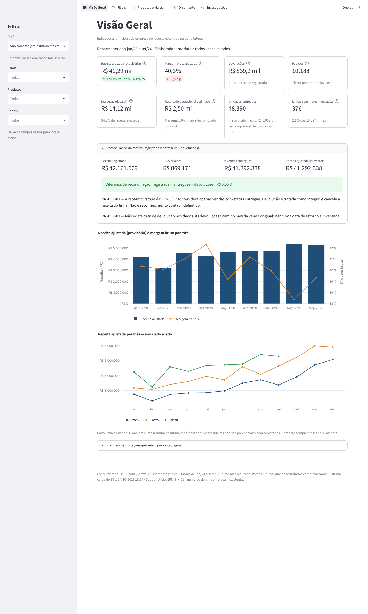
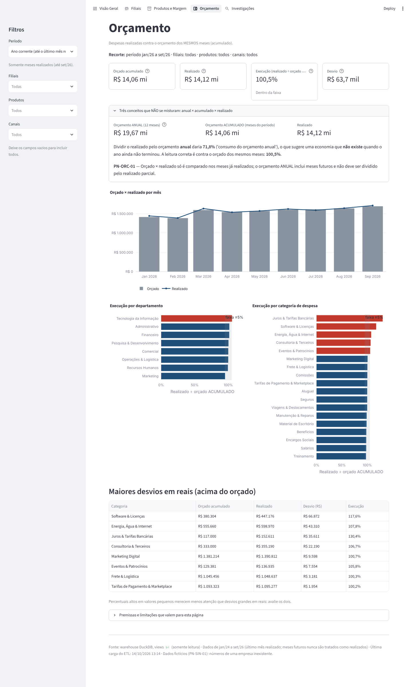
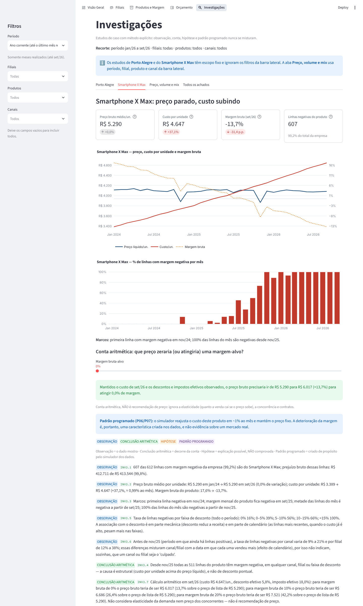
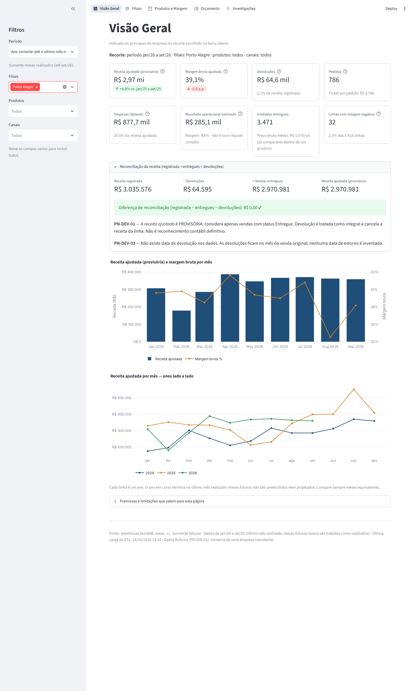

# Empresa X — Inteligência Comercial 360°

Projeto de portfólio de análise de dados: do CSV bruto ao aplicativo analítico, com ETL em camadas, SQL, investigações em Python, relatório executivo e suíte de testes.

> ## ⚠️ Dados 100% fictícios
> A "Empresa X", suas filiais, produtos, clientes e todos os números foram **gerados por um simulador** (`scripts/gerar_dados.py`, semente fixa). Alguns comportamentos (queda de margem, sazonalidade, eventos) foram **programados de propósito** e estão catalogados em [`docs/COMPORTAMENTOS_SINTETICOS.md`](docs/COMPORTAMENTOS_SINTETICOS.md). Nada aqui é evidência sobre empresas ou mercados reais: o objetivo é **demonstrar método**.

## Problema de negócio

Uma varejista de tecnologia com 8 filiais tem ~59 mil linhas de venda e ~7 mil lançamentos de despesa (jan/2024 a set/2026) espalhados em 13 CSVs. A diretoria quer saber: **como está o resultado? onde a margem está sendo corroída? uma queda anual é problema ou ruído? o gasto está dentro do orçamento?** — sem confundir receita provisória com definitiva, nem hipótese com causa.

## Arquitetura

```
data/*.csv (13 originais, intactos; SHA-256 em data/CHECKSUMS.sha256)
   │  scripts/run_etl.py   (uma transação; falha → ROLLBACK)
   ▼
raw (texto fiel) → stg (tipado, validado) → mart (estrela + KPIs) ──► ops (auditoria, 146 verificações)
                                                   │
        ┌──────────────────────────────────────────┼────────────────────────────────┐
        ▼                                          ▼                                ▼
sql/analise (8 análises, 21 resultados)   src/empresax/analise (6 investigações   schema bi (12 views) ──► app Streamlit (5 páginas,
 scripts/run_queries.py                    + relatório executivo, 69 achados)      scripts/run_powerbi.py   leitura somente)
                                           scripts/run_analises.py                 └► Power BI (roteiro + 290 valores de referência)
```

Cada camada tem testes; os números do app, do SQL, do pandas e de um cálculo em Python puro são conferidos entre si.

## Tecnologias

Python 3.12/3.13 · pandas · DuckDB (SQL) · SciPy · Plotly · Streamlit · pytest · Power BI (camada de consumo preparada, **ainda não validada** — veja Limitações).

## Principais resultados (dados fictícios)

- **Receita ajustada (provisória) jan–set/26: R$ 41,29 mi, +20,4%** sobre o mesmo período de 2025 — crescimento sobretudo de **volume** (decomposição preço × volume × mix × desconto × imposto reconciliada ao centavo).
- **Margem bruta 40,3%** (−1,5 p.p. vs. jan–set/25); margem operacional **estimada** 6,0% (não é lucro contábil).
- **Orçamento:** execução correta 100,5% (realizado ÷ orçado **acumulado**); a leitura ingênua (÷ orçamento anual) daria 71,8% e sugeriria uma "economia" falsa.

### Estudos de caso

| Caso | Pergunta | Conclusão (e seu limite) |
|---|---|---|
| **Porto Alegre, fev/26 (−48,9%)** | Perda de clientes ou efeito de base? | Pedidos −6,6%, linhas +2,9%, receita por linha −50,4%; um produto explica 62% da variação. É em grande parte base atípica; a **causa não é comprovada** (hipótese rotulada). |
| **Smartphone X Max** | Por que a margem some? | Preço fixo (R$ 5.290) e custo/un. +37,1%: margem 17,6% → −13,7%; 607 das 612 linhas com margem negativa da empresa são dele. Conta aritmética, **não** recomendação de preço. |
| **Preço × volume × mix** | O crescimento é "bom"? | Volume ≈ 92–93% da variação (92,8% da receita ajustada no app; 92% da registrada no relatório); o app reconcilia o total com resíduo R$ 0,00. |

Relatório completo: [`reports/executivo/RELATORIO_EXECUTIVO.md`](reports/executivo/RELATORIO_EXECUTIVO.md) (cada achado rotulado como OBSERVAÇÃO, CONCLUSÃO ARITMÉTICA, HIPÓTESE ou PADRÃO PROGRAMADO).

## O aplicativo (capturas reais)

| Visão Geral | Orçamento |
|---|---|
|  |  |
| **Investigações — Smartphone X Max** | **Filtro por filial (Porto Alegre)** |
|  |  |

Outras telas em [`reports/app_evidencias/`](reports/app_evidencias/) (Filiais, Produtos e Margem, preço × volume × mix, mobile). Regenerar: `scripts/capturar_evidencias_app.py` (opcional, usa Playwright).

## Instalação e execução no Windows

> Testado em **Linux** (Python 3.12 e 3.13). Os passos para Windows abaixo usam apenas comandos padrão do Python, mas **não foram executados no Windows** — se algo falhar, registre em uma *issue*.

1. Instale o **Python 3.12 ou 3.13** (python.org; marque *Add python.exe to PATH*). Confira: `py --version`.
2. Abra o *Prompt de Comando* na pasta do projeto e crie o ambiente virtual:
   ```bat
   py -3.13 -m venv .venv
   .venv\Scripts\activate.bat
   python -m pip install --upgrade pip
   pip install -r requirements-lock.txt
   ```
   (`requirements-lock.txt` = versões exatas testadas. No PowerShell use `.venv\Scripts\Activate.ps1`; se bloqueado, `Set-ExecutionPolicy -Scope Process RemoteSigned`.)
3. Gere tudo, **nesta ordem**:
   ```bat
   python scripts\run_etl.py          :: CSVs → warehouse\empresa_x.duckdb + reports\relatorio_qualidade.md
   python scripts\run_queries.py      :: 8 análises SQL → reports\consultas\*.csv
   python scripts\run_analises.py     :: 6 investigações + relatório executivo → reports\executivo\
   python scripts\run_powerbi.py      :: views bi + 290 valores de referência + docs do Power BI
   ```
4. Abra o aplicativo: `streamlit run app\streamlit_app.py` (http://localhost:8501). **Feche-o antes de rodar o ETL de novo** (o DuckDB aceita um único escritor).

Linux/macOS: troque `py -3.13` por `python3`, `.venv\Scripts\activate.bat` por `source .venv/bin/activate` e `\` por `/`.

## Como executar os testes

```bat
python -m pytest tests -q
```

**416 testes** (≈5 min; 4 deles são visuais, usam navegador real via Playwright/Chromium e são pulados se ele não estiver instalado), incluindo: oráculos independentes (pandas/Python puro), injeção de defeitos, **testes de mutação do aplicativo** (cada defeito de negócio injetado precisa ser detectado), segurança (SQL parametrizado, app somente leitura), determinismo (duas execuções → mesmos bytes) e preservação dos 13 CSVs originais. Detalhes e versões testadas: [`docs/AMBIENTE_E_REPRODUCAO.md`](docs/AMBIENTE_E_REPRODUCAO.md).

## Limitações e premissas de negócio

- **Dados sintéticos**: padrões foram programados; correlação nunca é lida como causa real (PN-SIN-01).
- **Receita ajustada é provisória** (PN-DEV-01): considera só vendas *Entregues*; devolução cancela a linha inteira e **não tem data** no dado — fica no mês da venda (PN-DEV-03). O custo recuperado na devolução é **hipótese** (PN-DEV-02). Ver [`docs/DEVOLUCOES.md`](docs/DEVOLUCOES.md).
- **Resultado operacional estimado ≠ lucro líquido contábil**; despesas não têm produto/canal (o app oculta o indicador nesses cortes).
- **Orçamento** só é comparado nos meses realizados; 2026 vai até set/26 e nunca se tratam meses futuros como realizados (PN-ORC-01).
- **Power BI: as 29 medidas DAX ainda NÃO foram executadas no Power BI Desktop.** Existem roteiro passo a passo, 290 valores de referência independentes e um conferidor automático; a validação é uma **pendência registrada**.
- Antes de usar de verdade: licença do projeto ainda **não definida** (veja `docs/DEPENDENCIAS_E_LICENCAS.md`).

Todas as premissas: [`docs/PREMISSAS_DE_NEGOCIO.md`](docs/PREMISSAS_DE_NEGOCIO.md).

## Documentação detalhada

| Tema | Documento |
|---|---|
| ETL, camadas, validações | [`docs/ETL.md`](docs/ETL.md) · [`docs/MODELO_DIMENSIONAL.md`](docs/MODELO_DIMENSIONAL.md) · [`docs/dicionario_de_dados.md`](docs/dicionario_de_dados.md) |
| Diagnóstico dos dados e devoluções | [`docs/DIAGNOSTICO.md`](docs/DIAGNOSTICO.md) · [`docs/DEVOLUCOES.md`](docs/DEVOLUCOES.md) |
| SQL e metodologia | [`docs/CONSULTAS_SQL.md`](docs/CONSULTAS_SQL.md) · [`docs/METODOLOGIA_DECOMPOSICAO.md`](docs/METODOLOGIA_DECOMPOSICAO.md) |
| Aplicativo | [`docs/APLICATIVO_STREAMLIT.md`](docs/APLICATIVO_STREAMLIT.md) |
| Power BI | [`docs/POWERBI_CAMADA_DE_CONSUMO.md`](docs/POWERBI_CAMADA_DE_CONSUMO.md) · [`docs/POWERBI_ROTEIRO_DE_CONSTRUCAO.md`](docs/POWERBI_ROTEIRO_DE_CONSTRUCAO.md) |
| Windows passo a passo e checklist do app | [`docs/GUIA_WINDOWS_PASSO_A_PASSO.md`](docs/GUIA_WINDOWS_PASSO_A_PASSO.md) · [`docs/CHECKLIST_VALIDACAO_APP.md`](docs/CHECKLIST_VALIDACAO_APP.md) |
| Ambiente, dependências, licenças | [`docs/AMBIENTE_E_REPRODUCAO.md`](docs/AMBIENTE_E_REPRODUCAO.md) · [`docs/DEPENDENCIAS_E_LICENCAS.md`](docs/DEPENDENCIAS_E_LICENCAS.md) |
| Auditoria final | [`docs/RELATORIO_DE_AUDITORIA.md`](docs/RELATORIO_DE_AUDITORIA.md) |
| Estudo e entrevista | [`docs/GUIA_DE_ESTUDO_E_ENTREVISTA.md`](docs/GUIA_DE_ESTUDO_E_ENTREVISTA.md) |
| Fase 1 (legado: SQLite, Power Query, DAX manual) | [`docs/legado/FASE1_BANCO_E_POWERBI.md`](docs/legado/FASE1_BANCO_E_POWERBI.md) |

## Como foi desenvolvido

Projeto de portfólio desenvolvido com **apoio de IA (Claude, da Anthropic)** para escrever código, testes e documentação, sob direção e revisão do autor, que definiu escopo, premissas de negócio e critérios de aceite em cada etapa. Veja a distinção detalhada no guia de entrevista.
<!-- TODO(autor): confirmar nome, links (LinkedIn/GitHub) e licença antes de publicar. -->
