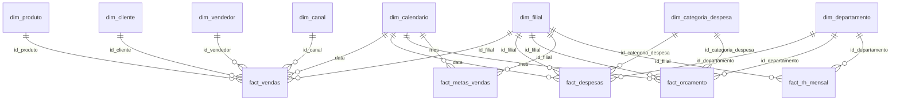

# Modelo dimensional (camada `mart`) — Empresa X

> Etapa 3. Descreve o modelo estrela que as análises SQL consomem. As tabelas são criadas pelo ETL (`sql/etl/mart/*.sql`); nada aqui altera as regras consolidadas da Etapa 2.

## Diagrama

## Grão de cada fato

| Fato | Grão (1 linha =) | Linhas | Medidas principais |
|---|---|---:|---|
| `fact_vendas` | **item de pedido** (pedido × produto) | 59.365 | quantidade, receita_bruta, desconto_valor, impostos_valor, receita_liquida, custo_total + colunas derivadas `receita_liquida_entregue`, `receita_liquida_devolvida`, `custo_entregue`, `eh_devolvida`, `flag_margem_negativa` |
| `fact_despesas` | lançamento (data × departamento × categoria × filial × fornecedor) | 7.075 | valor |
| `fact_orcamento` | mês × departamento × categoria × filial | 6.005 | valor_orcado |
| `fact_metas_vendas` | mês × filial | 270 | meta_receita_liquida, meta_margem_bruta_pct, meta_lucro_bruto |
| `fact_rh_mensal` | fim de mês × departamento × filial | 909 | headcount, headcount_planejado, admissões, desligamentos |

## Dimensões conformadas

`dim_calendario` (1.096 dias, com `primeiro_dia_mes` e `realizado`), `dim_filial` (8), `dim_produto` (39), `dim_canal` (4), `dim_departamento` (8), `dim_categoria_despesa` (18), `dim_cliente` (650), `dim_vendedor` (24).
"Conformada" = a mesma dimensão (mesmas chaves e rótulos) é usada por mais de um fato: `dim_filial` filtra vendas, despesas, orçamento, metas e RH; `dim_calendario` filtra todos. Por isso uma análise como "despesas ÷ receita por filial" funciona sem ambiguidade.

## Por que chaves naturais (e não surrogate keys)

Os ids (`id_filial`, `id_produto`…) já são inteiros estáveis, únicos e validados na Etapa 1 (0 órfãos nas 19 relações). Não há histórico de atributos (SCD) nos dados, então uma surrogate key só adicionaria uma tabela de tradução sem ganho. Se um dia houver mudança de atributo ao longo do tempo (ex.: produto trocar de categoria), a decisão deve ser reavaliada — limitação registrada.

## Estruturas derivadas usadas pelas análises

| Objeto | Tipo | Finalidade |
|---|---|---|
| `periodo_realizado` | tabela (1 linha) | Último mês realizado — **limite de todas as análises** (nenhum mês futuro entra) |
| `kpi_vendas_mes`, `kpi_preco_*`, `kpi_margem_negativa_*` | tabelas | KPIs da Etapa 2 |
| `kpi_devolucoes_*` | views | Reconciliação registrada = entregues + devoluções |
| `orcado_vs_realizado_mensal` / `_acumulado` | tabelas | Orçado × realizado só até o último mês realizado |
| `ref_premissas_negocio`, `ref_comportamentos_sinteticos` | view / tabela | PN-* e P01–P17: o que é premissa e o que o gerador programou |

Dicionário completo de colunas: `docs/dicionario_de_dados.md` (CSVs) e `docs/ETL.md` (camadas).

## Limitações do modelo

- Não há data da devolução: devoluções ficam no mês da **venda** (PN-DEV-03).
- `dim_produto.categoria` e `dim_filial.tipo` são atributos atuais; sem histórico.
- Despesas não têm vínculo com produto/canal — não é possível calcular margem por produto *depois* das despesas.
